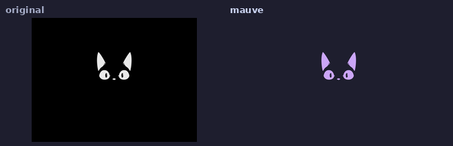
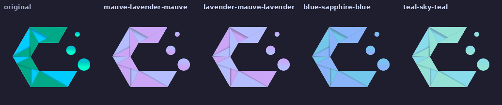

# catppuccinized-themes

Ready-to-use themes in [Catppuccin](https://catppuccin.com), made with
[catppuccinizer](https://github.com/erratos/catppuccinizer). They are sorted by
type; each folder has previews and install instructions.

| Type | Themes | |
|---|---|---|
| [**Plymouth**](plymouth/) (boot splash) | hexa_retro, infinite_seal (14 accents), each with a `-status` variant | [](plymouth/) |
| [**KDE splash**](ksplash/) (after login) | Breeze, CachyOS Nord, Kuro, Matrix code (glowing), Weaving Helix Ring | [](ksplash/) |
| [**Limine**](limine/) (boot menu) | Mocha colours + recoloured CachyOS wallpaper, mauve or lavender | [](limine/) |
| [**Wallpapers**](wallpapers/) | Cachy Topography, CachyOS Hello logo (SVG, 4 colour sets) | [](wallpapers/) |

All themes are in Catppuccin Mocha, except the Macchiato wallpaper.

## Download

Plymouth, KDE splash and Limine themes are attached to the
[Releases](https://github.com/erratos/catppuccinized-themes/releases) as
`<type>-<theme>.tar.gz`. Wallpapers are directly in the [wallpapers](wallpapers/)
folder.

Want another flavour or accent? Each folder shows the catppuccinizer command
that builds it.

## Rebuilding

```bash
./build.sh                    # all types: plymouth ksplash limine wallpapers
./build.sh ksplash            # one type
python3 previews.py           # the preview images of the READMEs
```

Needs [catppuccinizer](https://github.com/erratos/catppuccinizer)
(`CATPPUCCINIZE=../catppuccinizer/catppuccinize ./build.sh` to use a clone), and,
for the KDE splash screens and wallpapers, the original packages installed
(listed in each folder's credits). `build.sh` writes `themes/<type>/`, the
archives in `dist/`, and the wallpapers.

## Credits & licence

- Original works: see each folder (adi1090x, KDE, CachyOS, Kuro, Matrix code,
  Weaving Helix Ring). Every recolour keeps the licence of its original.
- Colours: [Catppuccin](https://github.com/catppuccin/catppuccin).
- Not affiliated with the official Catppuccin ports, KDE or CachyOS.
