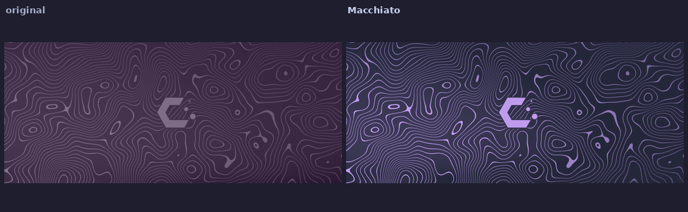
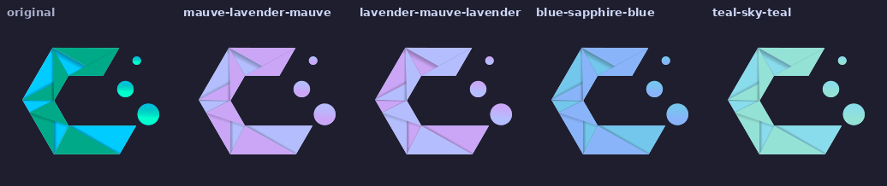

# Images: wallpapers and logos

[← All themes](../README.md)

The files are in this folder: open one and use *Download raw file*.

## Wallpaper: Cachy Topography (Macchiato)

[`Cachy_Topography-catppuccin-macchiato-mauve.png`](Cachy_Topography-catppuccin-macchiato-mauve.png)



## Logo: CachyOS Hello (SVG)

The CachyOS Hello icon in four Catppuccin Mocha colour sets. They stay vector
SVG, so they scale to any size (as an icon, on a wallpaper, in a dock…).



| File | Colours (outer · inner · bubbles) |
|---|---|
| [`org.cachyos.hello-catppuccin-mocha-mauve-lavender-mauve.svg`](org.cachyos.hello-catppuccin-mocha-mauve-lavender-mauve.svg) | mauve · lavender · mauve |
| [`org.cachyos.hello-catppuccin-mocha-lavender-mauve-lavender.svg`](org.cachyos.hello-catppuccin-mocha-lavender-mauve-lavender.svg) | lavender · mauve · lavender |
| [`org.cachyos.hello-catppuccin-mocha-blue-sapphire-blue.svg`](org.cachyos.hello-catppuccin-mocha-blue-sapphire-blue.svg) | blue · sapphire · blue |
| [`org.cachyos.hello-catppuccin-mocha-teal-sky-teal.svg`](org.cachyos.hello-catppuccin-mocha-teal-sky-teal.svg) | teal · sky · teal |

To use one as the CachyOS Hello app icon, for your user only:

```bash
mkdir -p ~/.local/share/icons/hicolor/scalable/apps
cp org.cachyos.hello-catppuccin-mocha-mauve-lavender-mauve.svg \
   ~/.local/share/icons/hicolor/scalable/apps/org.cachyos.hello.svg
```

## Your own images

```bash
catppuccinize image ~/Pictures/wall.jpg -f macchiato
```

See [catppuccinizer](https://github.com/erratos/catppuccinizer).

## Credits

- Cachy Topography: [cachyos-wallpapers](https://github.com/cachyos/cachyos-wallpapers) (GPL-1.0).
- CachyOS Hello icon: [cachyos-welcome](https://github.com/cachyos/cachyos-welcome) (GPL-3.0+).
  CachyOS name and logo belong to the CachyOS project; this is an unofficial recolour.
