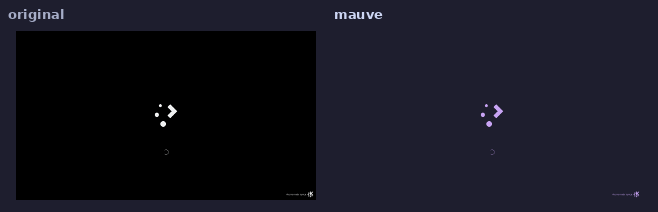
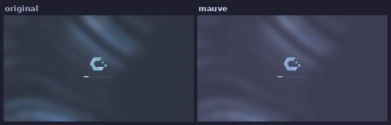
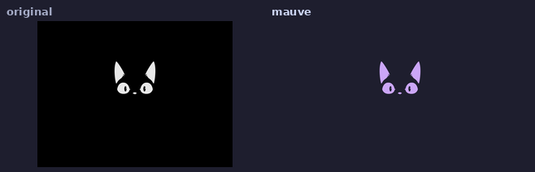
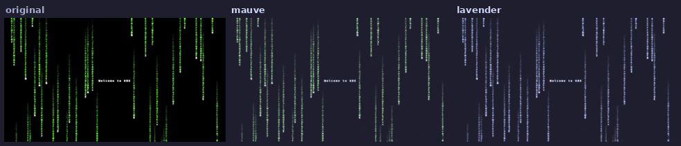
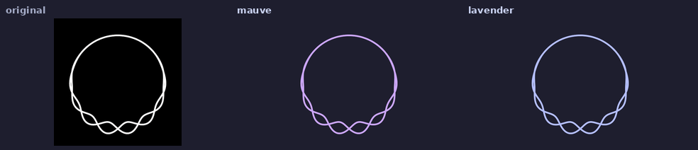

# KDE Plasma splash screens

[← All themes](../README.md)

Splash screens shown after login, recoloured in Catppuccin Mocha. Each one is
a look-and-feel package that contains only the splash screen, so installing it
does not change the rest of your desktop theme.

## Breeze

KDE's default splash. `catppuccin-mocha-breeze-mauve`



## CachyOS Nord

`catppuccin-mocha-cachyos-nord-mauve`



## Kuro

An animated cat. `catppuccin-mocha-kuro-mauve`



## Matrix code "Welcome to KDE" (glowing)

Matrix rain, kept green in the mauve version, recoloured in the lavender one.
`catppuccin-mocha-matrix-code-welcome-to-kde-glowing-{mauve,lavender}`
(about 40 MB each: the animation is a 581-frame WebP).



## Weaving Helix Ring Dark

`catppuccin-mocha-weaving-helix-ring-dark-{mauve,lavender}`



## Install

Download `ksplash-<theme>.tar.gz` from the [Releases](https://github.com/erratos/catppuccinized-themes/releases), then:

```bash
tar xf ksplash-catppuccin-mocha-kuro-mauve.tar.gz
mkdir -p ~/.local/share/plasma/look-and-feel
cp -r catppuccin-mocha-kuro-mauve ~/.local/share/plasma/look-and-feel/
```

Then pick it in *System Settings → Colours & Themes → Splash Screen*. To see it
without logging out:

```bash
ksplashqml --test --window ~/.local/share/plasma/look-and-feel/catppuccin-mocha-kuro-mauve
```

## Other flavours and accents

With [catppuccinizer](https://github.com/erratos/catppuccinizer) and the
original splash screen installed (from the KDE Store or its repository):

```bash
catppuccinize ksplash a2n.kuro -f macchiato -a teal --install
catppuccinize ksplash --list        # splash screens installed on your machine
```

## Credits

The recoloured packages keep the original authors and licence in their
`metadata.json`.

| Splash screen | Author | Licence | Source |
|---|---|---|---|
| Breeze | KDE Visual Design Group | GPL-2.0+ | [kde.org](https://www.kde.org) |
| CachyOS Nord | CachyOS Visual Design Group | GPL-2.0+ | [cachyos.org](https://cachyos.org/) |
| Kuro | Alan Bouteiller (a2n) | GPL-3.0 | [bouteillerAlan/kuro](https://github.com/bouteillerAlan/kuro) |
| Matrix code 'Welcome to KDE' (glowing) | kloud | GPL-3.0 | [dgudim/themes](https://github.com/dgudim/themes) |
| Weaving Helix Ring Dark | Crow | Unlicense | [Celeths](https://github.com/Celeths) |
