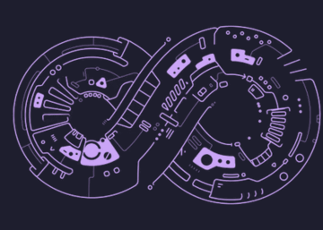
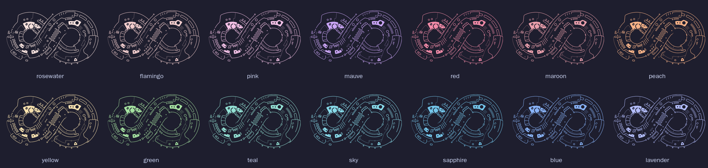
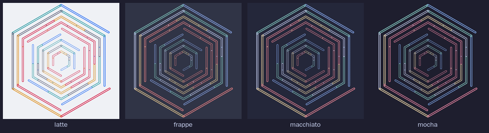

# Plymouth boot splash

[← All themes](../README.md)

Two boot animations by [adi1090x](https://github.com/adi1090x/plymouth-themes),
recoloured in Catppuccin Mocha.

| hexa_retro | infinite_seal (mauve) |
|:---:|:---:|
|  |  |
| `catppuccin-mocha-hexa-retro` | `catppuccin-mocha-infinite-seal-<accent>` |
| white → `text`, red → `red`, yellow → `yellow`, blue → `blue`, cyan → `teal` | white → accent |

infinite_seal comes in the 14 Mocha accents:



Every theme also has a `…-status` variant: a thin progress bar and the last
systemd services started, under the animation.

## Install

Download `plymouth-<theme>.tar.gz` from the [Releases](https://github.com/erratos/catppuccinized-themes/releases), then:

```bash
tar xf plymouth-catppuccin-mocha-infinite-seal-mauve.tar.gz
sudo cp -r catppuccin-mocha-infinite-seal-mauve /usr/share/plymouth/themes/
sudo plymouth-set-default-theme -R catppuccin-mocha-infinite-seal-mauve
```

`-R` rebuilds the initramfs, needed for the theme to show at boot. On KDE you
can also pick it in *System Settings → Boot Splash Screen* once copied. Make
sure `splash` is on your kernel command line and the `plymouth` hook is in your
initramfs (`HOOKS=(… plymouth …)` in `/etc/mkinitcpio.conf`).

## Other flavours and accents

The releases contain Mocha. Any other combination takes one command with
[catppuccinizer](https://github.com/erratos/catppuccinizer):



```bash
catppuccinize plymouth hexa_retro -f latte
catppuccinize plymouth infinite_seal -f macchiato -a teal --install
```

## Credits

Original animations: [Aditya Shakya (@adi1090x)](https://github.com/adi1090x/plymouth-themes), GPL-3.0.
